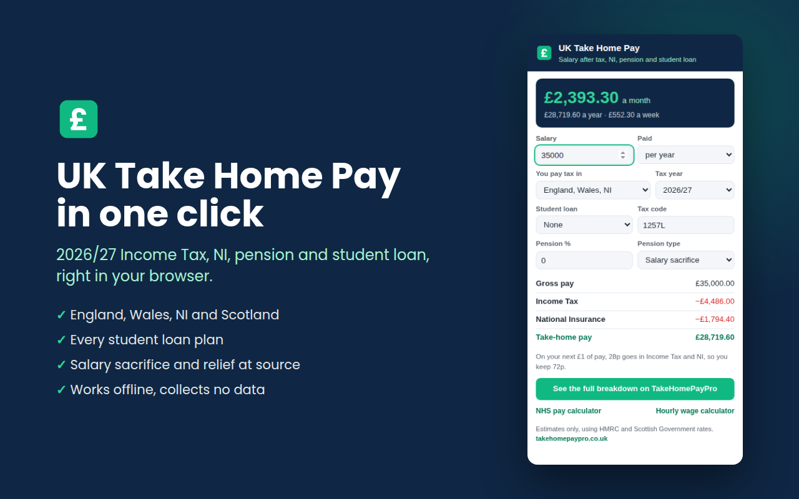

# UK Take Home Pay Calculator (browser extension)

Work out your UK take-home pay in one click, straight from your browser toolbar. Updated for the **2026/27 tax year**.

Made by [TakeHomePayPro](https://takehomepaypro.co.uk), a free UK salary calculator site.

## What it does

- Salary after Income Tax, National Insurance, pension and student loan
- England, Wales and Northern Ireland, plus Scotland's six tax bands
- Every student loan plan: Plan 1, 2, 4, 5 and Postgraduate
- Salary sacrifice, net pay and relief at source pensions
- Tax codes including S and C prefixes, emergency codes, BR, D0, D1, K and NT
- Shows how much of your next £1 of pay you keep
- Tax years 2024/25, 2025/26 and 2026/27

For a full breakdown, the NHS pay calculator or the hourly wage calculator, visit
**[takehomepaypro.co.uk](https://takehomepaypro.co.uk)**.

## Install

- Chrome: Chrome Web Store (link coming soon)
- Microsoft Edge: Edge Add-ons (link coming soon)
- Firefox: Firefox Add-ons (link coming soon)

Or load it yourself: open `chrome://extensions`, turn on Developer mode, choose **Load unpacked** and pick the `src` folder.

## Privacy

The extension needs no permissions, makes no network requests and collects no data.
Your last inputs are kept only in your own browser so the popup remembers them.
See [PRIVACY.md](PRIVACY.md).

## How the numbers are worked out

`src/engine.js` is the same calculation engine used on
[takehomepaypro.co.uk](https://takehomepaypro.co.uk). Rates come from HMRC, GOV.UK and the
Scottish Government. Figures are estimates for guidance, not financial advice.

## Licence

MIT, see [LICENSE](LICENSE).
